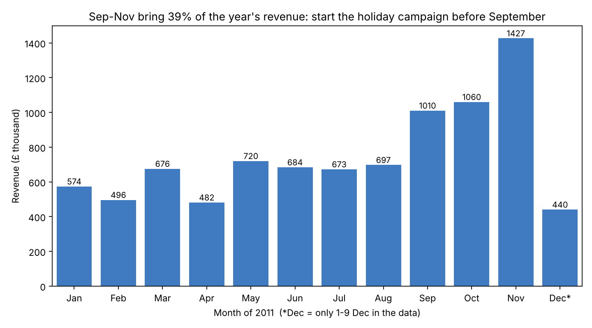
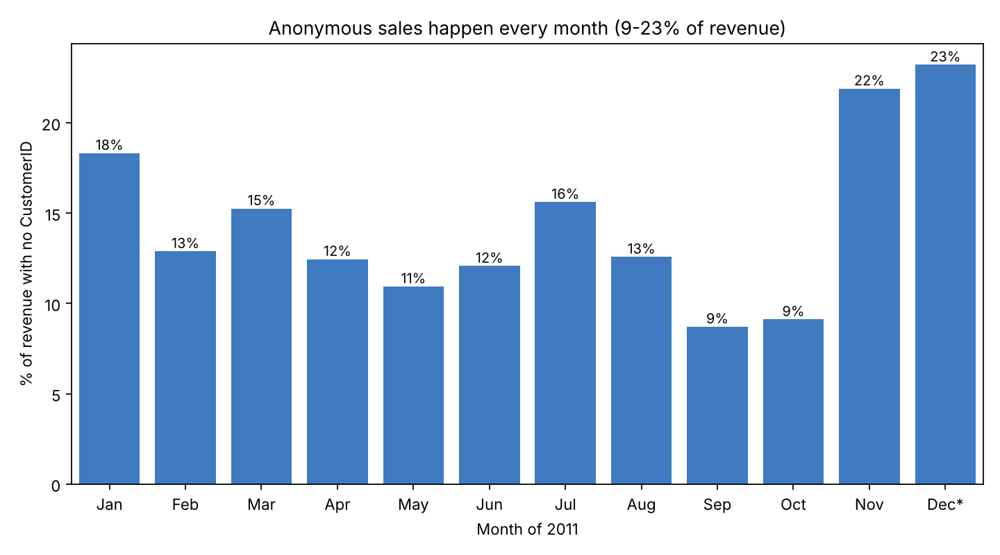
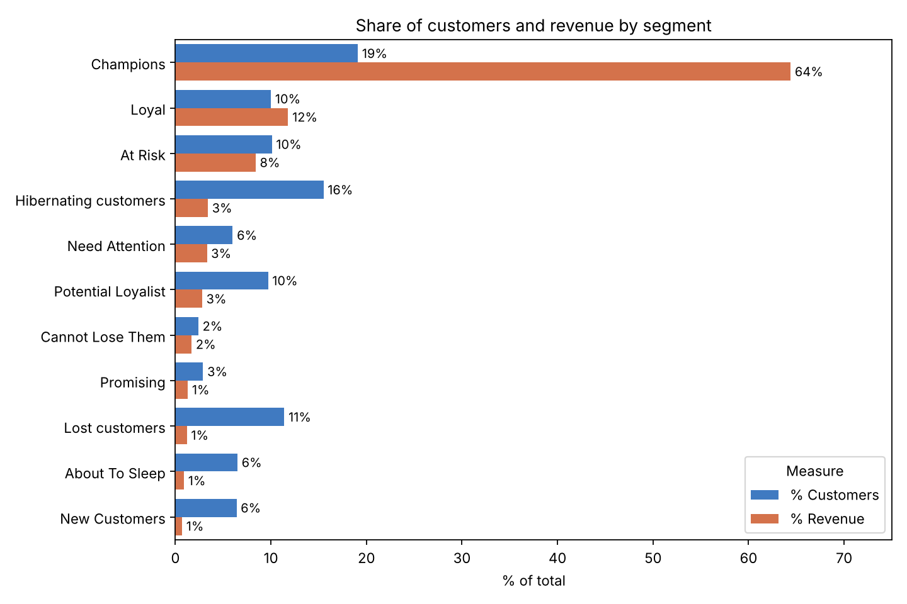
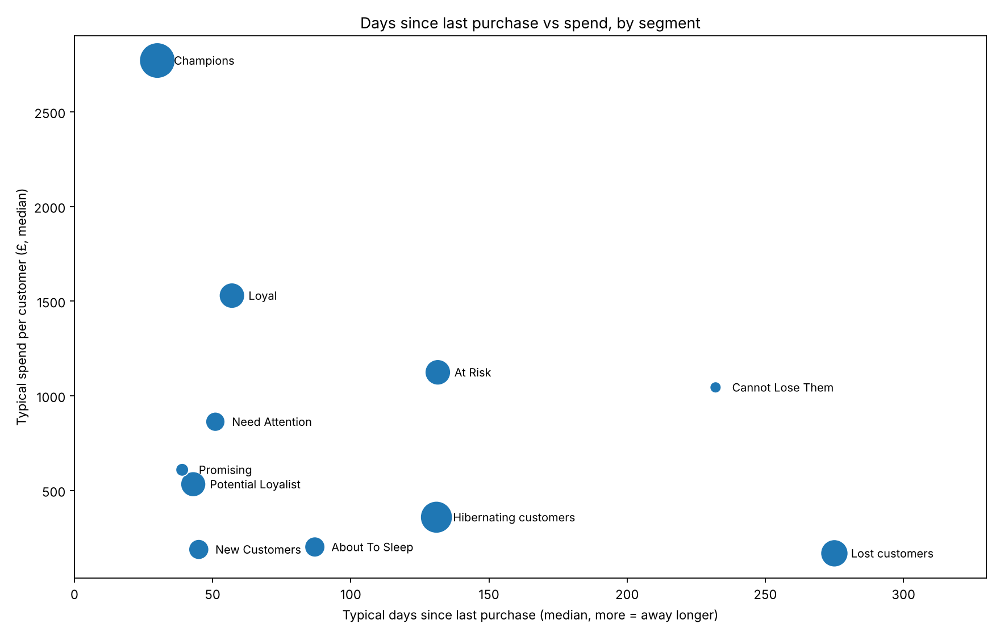
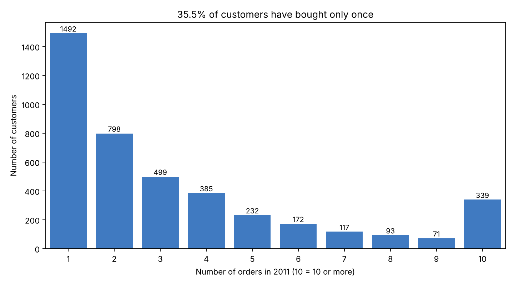
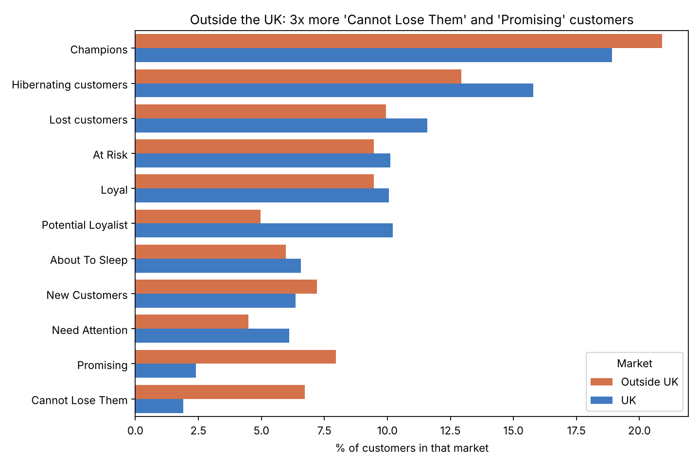

# 🛒 Customer Segmentation for a Holiday Marketing Campaign | RFM Analysis in Python

**Author:** [Your name]

**Date:** October 2026

**Tools used:** Python (pandas, seaborn, matplotlib) on Google Colab

---

## 📑 Table of Contents

1. [📌 Objective](#1-objective)
2. [📂 Dataset](#2-dataset)
3. [🧹 Data Cleaning](#3-data-cleaning)
4. [🔍 Exploratory Analysis](#4-exploratory-analysis)
5. [🧮 RFM Model](#5-rfm-model)
6. [📊 Analysis](#6-analysis)
7. [💡 Insight & Recommendation](#7-insight--recommendation)
8. [⚠️ Assumptions & Limitations](#8-assumptions--limitations)
9. [📁 Files in this repository](#9-files-in-this-repository)

---

## 1. Objective

### What is this project about?

SuperStore is an online retailer based in the UK. Many of its customers order in large quantities, like small shops and wholesalers, and some of them are in other countries.

The Marketing team wants to run personalised campaigns for **Christmas and New Year**. With more than 4,000 customers, grouping them by hand is not practical.

This project uses the **RFM model** in Python to group customers by how they buy, and then recommends **who to target, with which offer, and when**.

- **Recency (R):** how many days since the customer's last purchase
- **Frequency (F):** how many orders the customer placed
- **Monetary (M):** how much money the customer spent in total (after cancellations)

### Who is this project for?

- ✔️ **Marketing team:** to plan the holiday campaign for each customer group
- ✔️ **Sales / customer care team:** to know which valuable customers to contact directly
- ✔️ **Managers:** to decide the campaign budget

### Business Questions

1. **When** should the holiday campaign start?
2. **How** can customers be grouped by their buying behaviour?
3. **Which** groups bring the most revenue, and which valuable groups are about to leave?
4. **What** offer should each group get, and roughly **how much** will the vouchers cost?
5. Among Recency, Frequency and Monetary, **which one matters most** for SuperStore?

### Project Outcome

- Cleaned **541,909** raw lines into **490,283** lines of 2011 sales (**£8.94M** revenue) and scored **4,198** customers.
- Grouped customers into **11 RFM segments**, then into **4 action groups**: Keep, Win back, Grow, Save cost.
- Key findings:
    - **29%** of customers (Champions + Loyal) bring **76%** of revenue.
    - **521** valuable customers (At Risk + Cannot Lose Them) have been away for **4–8 months**. Together they spent **£772k** in 2011.
    - **35.5%** of customers bought **only once**. The second order is the biggest bottleneck.
    - **September–November** bring **39%** of the year's revenue.
- A voucher plan with a **maximum budget of about £77.7k**.
- Answer to question 5: **Frequency** matters most.

---

## 2. Dataset

One Excel file with two sheets:

| Sheet | Content | Size |
|---|---|---|
| `ecommerce retail` | One row = one product line in an order (01/12/2010 – 09/12/2011) | 541,909 rows × 8 columns |
| `Segmentation` | 11 customer segments and the RFM codes that belong to each one | 11 rows |

<details>
<summary>📋 Columns of the <code>ecommerce retail</code> sheet (click to expand)</summary>

| Column | Meaning |
|---|---|
| `InvoiceNo` | Order number. If it starts with **"C"**, the order was cancelled |
| `StockCode` | Product code. Some codes are not products (postage, bank charges, ...) |
| `Description` | Product name |
| `Quantity` | Number of units in the line (negative for cancellations) |
| `InvoiceDate` | Date and time of the order |
| `UnitPrice` | Price per unit, in pounds (£) |
| `CustomerID` | Customer number (empty for some lines) |
| `Country` | Customer's country |

</details>

---

## 3. Data Cleaning

Each cleaning rule was checked by printing the number of rows after it.

| Step | Rule | Why | Rows left |
|---|---|---|---|
| Start | Raw data | | 541,909 |
| 1 | Remove exact duplicate rows | Same invoice, product, quantity, price and minute = recorded twice | 536,641 |
| 2 | Keep only 2011 | The brief asks for 2011 | 494,660 |
| 3 | Remove lines with unit price ≤ 0 | Stock adjustments and bad debt, not sales to customers | 492,419 |
| 4 | Remove non-product codes | Postage, bank charges, Amazon fees, samples, gift vouchers are not product sales | **490,283** |

Other decisions:

- **Cancelled orders** ("C" invoices) are **kept and subtracted** from Monetary, but **not counted** as an order in Frequency.
- **Discount (`D`) and Manual (`M`) lines are kept**, because they change what the customer really paid. For example, one customer's £38,970 order was cancelled with a single Manual line.
- **Lines with no CustomerID** are kept for total revenue but **left out of RFM**, because they cannot be linked to a customer.

```python
# Remove duplicate rows (same invoice, product, quantity, price and time)
df = df.drop_duplicates()

# Keep only 2011
df = df[df["InvoiceDate"].dt.year == 2011]

# Remove lines with unit price <= 0 (stock adjustments, bad debt)
df = df[df["UnitPrice"] > 0]

# Remove codes that are not products
# Keep "D" (discount) and "M" (manual): they change what the customer really paid
remove_codes = ["S", "POST", "DOT", "C2", "BANK CHARGES", "AMAZONFEE", "CRUK", "B"]
code = df["StockCode"].astype(str).str.upper()
df = df[~code.isin(remove_codes) & ~code.str.startswith("GIFT")]

# Two tables for two goals
df_total = df.copy()                            # all customers: for total revenue
df_rfm = df[df["CustomerID"].notna()].copy()    # known customers only: for RFM
```

---

## 4. Exploratory Analysis

### 4.1 Revenue by month



- **September–November** bring **39.1%** of the year's revenue.
- In those months, revenue is about **£1.17M per month**, almost **double** the **£625k** average of January–August.
- December looks low only because the data stops on **9 December**.

➡️ The holiday campaign should start **before September**, not in December.

### 4.2 Customers with no ID: spread out or concentrated?



- **14.4%** of revenue has no CustomerID.
- **Over time, it is spread out:** every month has anonymous sales (9–23% of revenue).
- **By market, it is concentrated:** **98%** of anonymous revenue is in the **UK**. In the UK, 16.8% of revenue has no ID; outside the UK, only 1.8%.

➡️ The RFM results miss about 1 in 6 pounds of UK sales. Customers outside the UK are almost all identified.

```python
df_total["Month"] = df_total["InvoiceDate"].dt.month
monthly = df_total.groupby("Month")["Revenue"].sum() / 1000     # in £ thousand
print("Share of Sep-Nov:", round(monthly.loc[9:11].sum() / monthly.sum() * 100, 1), "%")
```

---

## 5. RFM Model

### Step 1. Build one row per customer

R, F and M are measured on **31/12/2011**, as the brief asks.

```python
REF_DATE = pd.Timestamp("2011-12-31")

# Frequency: count different invoices, real purchases only (no cancelled orders)
purchases = df_rfm[~df_rfm["IsCancel"]]
rfm = purchases.groupby("CustomerID").agg(
    LastPurchase=("InvoiceDate", "max"),
    Frequency=("InvoiceNo", "nunique")
)

# Monetary: all money of the customer, cancels and discounts included (net)
rfm["Monetary"] = df_rfm.groupby("CustomerID")["Revenue"].sum().round(2)

# Recency: days from the last purchase day to REF_DATE
rfm["Recency"] = (REF_DATE - rfm["LastPurchase"].dt.normalize()).dt.days

# Remove customers who gave no money in the end (they cancelled everything)
rfm = rfm[rfm["Monetary"] > 0].copy()
```

Result: **4,198** customers. 21 customers with net spending of £0 or less, and 24 customers who only had cancellations in 2011, are not scored.

### Step 2. Score R, F, M from 1 to 5 (quintiles)

**35.5%** of customers bought only once, so many customers have the same Frequency. `qcut` cannot cut equal groups when one value is that common, so each customer first gets a unique position with `rank`.

```python
# Rank first, so customers with the same value still split into 5 equal groups
rfm["R_rank"] = rfm["Recency"].rank(method="first")
rfm["F_rank"] = rfm["Frequency"].rank(method="first")
rfm["M_rank"] = rfm["Monetary"].rank(method="first")

# Recency: fewer days = better, so labels go 5 -> 1
rfm["R"] = pd.qcut(rfm["R_rank"], q=5, labels=[5, 4, 3, 2, 1]).astype(int)
rfm["F"] = pd.qcut(rfm["F_rank"], q=5, labels=[1, 2, 3, 4, 5]).astype(int)
rfm["M"] = pd.qcut(rfm["M_rank"], q=5, labels=[1, 2, 3, 4, 5]).astype(int)
rfm["RFM_Score"] = rfm["R"].astype(str) + rfm["F"].astype(str) + rfm["M"].astype(str)
```

### Step 3. Give each customer a segment (like VLOOKUP)

```python
segments = {
    "Champions": "555 554 544 545 454 455 445",
    "Loyal":     "543 444 435 355 354 345 344 335",
    # ... 9 more segments, typed from the Segmentation sheet
}

lookup = {}
for name, codes in segments.items():
    for code in codes.split():
        lookup[code] = name

rfm["Segment"] = rfm["RFM_Score"].map(lookup)    # 125 codes, 0 customers without a segment
```

### Step 4. Segment summary

Rule: **the whole group → `sum`**, **one typical customer → `median`**. The median is used because a few very big customers pull the average up. For Champions, the average spend is £6,160 but the median is £2,772.

```python
rfm["OrderValue"] = rfm["Monetary"] / rfm["Frequency"]     # value of one typical order

summary = rfm.groupby("Segment").agg(
    Customers=("Monetary", "size"),
    Revenue=("Monetary", "sum"),
    MedianRecency=("Recency", "median"),
    MedianFrequency=("Frequency", "median"),
    MedianSpend=("Monetary", "median"),
    MedianOrder=("OrderValue", "median"),
)
summary["% Customers"] = summary["Customers"] / summary["Customers"].sum() * 100
summary["% Revenue"] = summary["Revenue"] / summary["Revenue"].sum() * 100
```

| Segment | Customers | % customers | % revenue | Days since last order | Orders | Spend in 2011 | One order |
|---|---:|---:|---:|---:|---:|---:|---:|
| Champions | 802 | 19.1% | 64.4% | 30 | 8 | £2,772 | £346 |
| Loyal | 420 | 10.0% | 11.8% | 57 | 4 | £1,529 | £339 |
| At Risk | 422 | 10.1% | 8.4% | 132 | 3 | £1,124 | £384 |
| Hibernating customers | 651 | 15.5% | 3.4% | 131 | 1 | £359 | £279 |
| Need Attention | 250 | 6.0% | 3.3% | 51 | 3 | £863 | £278 |
| Potential Loyalist | 408 | 9.7% | 2.8% | 43 | 2 | £533 | £219 |
| Cannot Lose Them | 99 | 2.4% | 1.7% | 232 | 1 | £1,045 | £739 |
| Promising | 123 | 2.9% | 1.3% | 39 | 1 | £609 | £524 |
| Lost customers | 480 | 11.4% | 1.2% | 275 | 1 | £168 | £159 |
| About To Sleep | 273 | 6.5% | 0.9% | 87 | 1 | £201 | £184 |
| New Customers | 270 | 6.4% | 0.7% | 45 | 1 | £188 | £182 |

*Days, orders, spend and one order are medians. % revenue is the share of the £7.67M spent by the 4,198 scored customers.*

---

## 6. Analysis

### 6.1 A small group brings most of the money



- **Champions:** 19% of customers bring **64%** of revenue.
- Only **Champions and Loyal** bring more revenue than their share of customers. Together: **29%** of customers, **76%** of revenue.
- Hibernating, About To Sleep and Lost are **33%** of customers but only **5.5%** of revenue.

### 6.2 Valuable customers are drifting away



- In **At Risk** (422 customers) and **Cannot Lose Them** (99), a typical customer spent over £1,000 in 2011, but they have been away for about **4 and 8 months**.
- Together they spent **£772k** in 2011.
- **At Risk and Hibernating have been away equally long (about 131 days)**, but a typical At Risk customer spent **3 times more** (£1,124 vs £359) and ordered 3 times instead of once. Only At Risk is worth an expensive win-back effort.

### 6.3 The second order is the bottleneck



```python
freq = rfm["Frequency"].clip(upper=10)      # put everyone with 10+ orders into "10"
ax = sns.countplot(x=freq, color="#2a78d6")
ax.bar_label(ax.containers[0], fontsize=9)
```

- **1,492 customers (35.5%)** placed only one order in 2011.
- The number of customers almost **halves** from 1 order (1,492) to 2 orders (798). After that, it goes down slowly.
- Part of this is timing: **558** of the one-time buyers (37%) made that purchase in October–December, so they have not had much time to come back yet.

### 6.4 Customers outside the UK



- Customers outside the UK are **9.6%** of customers but **18.2%** of revenue. A typical one spends **£901**, against **£623** in the UK.
- They are about **3 times** more likely to be **Cannot Lose Them** (6.7% vs 1.9%) or **Promising** (8.0% vs 2.4%): big orders, but less often.
- These groups are small: 27 and 32 customers outside the UK.

### 6.5 Voucher cost estimate

For each group: how big the voucher is compared with one typical order, and the **maximum budget if every customer uses it once**.

```python
def voucher_check(segment, percent_off, cap):
    customers = summary.loc[segment, "Customers"]
    order = summary.loc[segment, "MedianOrder"]
    voucher = min(order * percent_off, cap)
    print(f"{segment}: {customers} customers | typical order £{order:,.0f} | "
          f"voucher £{voucher:,.0f} ({voucher / order * 100:.0f}% of the order) | "
          f"max budget £{customers * voucher:,.0f}")

voucher_check("At Risk", 0.20, 100)             # 20% off, max £100
```

| Group | Customers | One typical order | Voucher | % of the order | Max budget |
|---|---:|---:|---:|---:|---:|
| Cannot Lose Them (20% off) | 99 | £739 | £148 | 20% | £14,624 |
| At Risk (20% off, max £100) | 422 | £384 | £77 | 20% | £32,401 |
| New Customers (20% off, max £30) | 270 | £182 | £30 | 17% | £8,100 |
| About To Sleep (50% off, max £30) | 273 | £184 | £30 | 16% | £8,190 |
| Lost customers (50% off, max £30) | 480 | £159 | £30 | 19% | £14,400 |
| **Total** | | | | | **£77,716** |

---

## 7. Insight & Recommendation

| # | Insight (what the data shows) | Recommendation (what the business should do) |
|---|---|---|
| 1 | **Timing:** September–November bring 39% of the year's revenue; monthly revenue almost doubles from September. | Start the holiday campaign at the **end of August**, and have stock, budget and email plans ready before September. |
| 2 | **Concentration:** Champions + Loyal are 29% of customers but bring 76% of revenue. | **Keep them:** thank-you gifts, early access to new products, free delivery. **No deep discounts:** they already buy often. |
| 3 | **Valuable customers drifting away:** 521 At Risk and Cannot Lose Them customers spent £772k but have been away 4–8 months. | **Win them back before Christmas:** a personal email for At Risk (20% voucher, max £100) and a **phone call** for the 99 Cannot Lose Them customers. |
| 4 | **Second-order bottleneck:** 35.5% of customers bought only once; the count almost halves from 1 to 2 orders. | **Grow them:** a voucher for the **next order** within 30 days (with a minimum spend) for New Customers, Promising, Potential Loyalist and Need Attention. |
| 5 | **Frequency matters most:** a typical order is about the same size in Champions (£346), Loyal (£339) and At Risk (£384). Champions are worth more because they order **8 times** a year. | Measure the campaign by **repeat orders** (how many customers place another order), not only by sales. |
| 6 | **Low-value groups:** Hibernating, About To Sleep and Lost are 33% of customers but only 5.5% of revenue. | **Save cost:** automated emails only, voucher capped at £30, no paid ads for these groups. |
| 7 | **Outside the UK:** 9.6% of customers bring 18.2% of revenue; typical spend £901 vs £623 in the UK; 3× more Cannot Lose Them and Promising. | Offer **free or cheaper international shipping** instead of price discounts, and contact the 27 Cannot Lose Them and 32 Promising customers abroad. |
| 8 | **Anonymous sales:** 14.4% of revenue cannot be linked to a customer; 98% of it is in the UK. | Encourage UK buyers to **create an account at checkout** (for example with a small welcome offer), so they can be targeted next year. |

### Action plan by group

| Action group | Segments | Goal | Main action |
|---|---|---|---|
| **1. Keep** | Champions, Loyal | Do not lose them | Gifts, early access, free delivery; no deep discounts |
| **2. Win back** | At Risk, Cannot Lose Them | One more order before Christmas | Personal email or phone call + 20% voucher |
| **3. Grow** | New Customers, Promising, Potential Loyalist, Need Attention | A second (or next) order | Voucher on the next order, with a minimum spend |
| **4. Save cost** | Hibernating, About To Sleep, Lost | Low-cost reminders | Automated email, voucher capped at £30 |
| *All groups outside the UK* | | | *Shipping offer instead of a price discount* |

---

## 8. Assumptions & Limitations

- **Only 2011 data**, and December stops on 9 December. Recency is measured on 31/12/2011, as the brief asks.
- **Equal groups with `rank`:** customers with the same value can get different scores. For example, 652 customers with only one order got F = 2 instead of 1.
- **Manual (`M`) lines are kept** because most of them record cancellations. A few manual lines have an unclear meaning.
- **Voucher budget is a maximum** (every customer uses the voucher once). The real usage and the profit margin are unknown, because the data has no cost information.
- **Revenue is not profit:** the cost of the products is not in the data.
- **Why** customers leave cannot be measured: the data has no information about satisfaction or marketing.
- 7 customers ordered from two countries; their first country is used.

---

## 9. Files in this repository

```
├── README.md                              <- this file
├── RFM_SuperStore_final.ipynb             <- full Python code (Google Colab)
├── RFM_SuperStore_presentation.pptx       <- slides for the Marketing team
└── images/                                <- charts used in this README (the slides use editable PowerPoint charts)
    ├── 01_revenue_by_month.png
    ├── 02_anonymous_sales_by_month.png
    ├── 03_customers_vs_revenue_by_segment.png
    ├── 04_recency_vs_spend_by_segment.png
    ├── 05_orders_per_customer.png
    └── 06_segment_mix_uk_vs_outside.png
```
