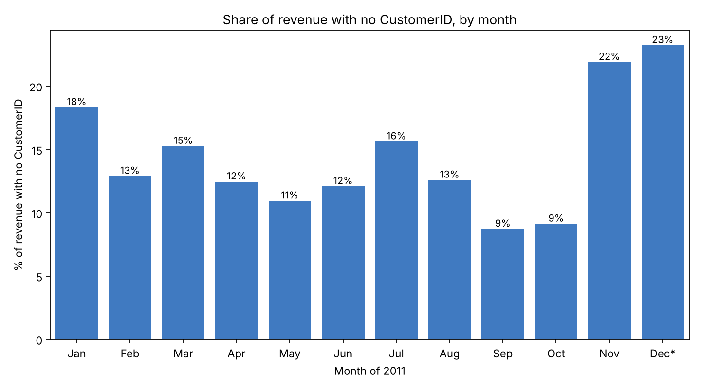
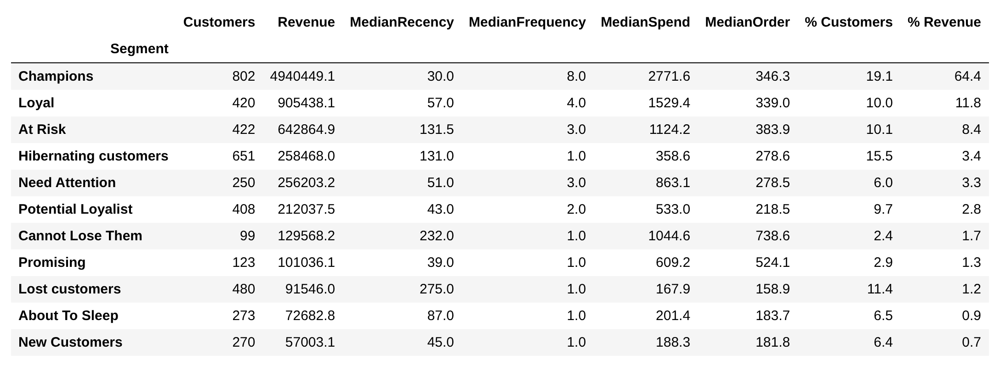

# 🛒 Customer Segmentation for a Holiday Marketing Campaign | RFM Analysis in Python


**Full code:** [Google Colab notebook](https://colab.research.google.com/drive/1l3cCun2EM1hxZDtGRDau9P2ns4WOClXZ?usp=sharing)

---

## 1. Objective

### What is this project about?

SuperStore is an online store in the UK. Many of its customers are small shops that buy in large amounts, and some of them are in other countries.

The Marketing team wants to give each type of customer the right offer for **Christmas and New Year**. There are more than 4,000 customers, so grouping them by hand would take too long.

This project uses the **RFM model** in Python to group customers by how they buy. Then it shows **which customers to focus on, what offer to give them, and when to start**.

- **Recency (R):** how many days since the customer's last purchase
- **Frequency (F):** how many orders the customer placed
- **Monetary (M):** how much money the customer spent in total (after cancellations)

### Who is this project for?

- ✔️ **Marketing team:** to plan the holiday campaign for each customer group
- ✔️ **Sales / customer care team:** to know which important customers to call or email
- ✔️ **Managers:** to decide the campaign budget

### Business Questions

1. **When** should the holiday campaign start?
2. **How** can customers be grouped by the way they buy?
3. **Which** groups bring the most revenue, and which big-spending groups are about to leave?
4. **What** offer should each group get, and about **how much** will the vouchers cost?
5. Among Recency, Frequency and Monetary, **which one matters most** for SuperStore?

### Project Outcome

- Cleaned **541,909** raw rows into **490,283** rows of 2011 sales (**£8.94M** revenue) and scored **4,198** customers.
- Put customers into **11 RFM segments**, then into **4 action groups**: Keep, Win back, Grow, Save cost.
- Key findings:
    - **29%** of customers (Champions + Loyal) bring **76%** of revenue.
    - **521** big-spending customers (At Risk + Cannot Lose Them) have not bought anything for **4–8 months**. Together they spent **£772k** in 2011.
    - **35.5%** of customers bought **only once**. Getting the second order is the biggest problem.
    - **September–November** bring **39%** of the year's revenue.
- A voucher plan with a **maximum budget of about £77.7k**.
- Answer to question 5: **Frequency** matters most.

---

## 2. Dataset

One Excel file with two sheets:

| Sheet | What is inside | Size |
|---|---|---|
| `ecommerce retail` | One row = one product in an order (01/12/2010 – 09/12/2011) | 541,909 rows × 8 columns |
| `Segmentation` | 11 customer segments and the RFM scores that belong to each one | 11 rows |

<details>
<summary>📋 Columns of the <code>ecommerce retail</code> sheet (click to open)</summary>

| Column | Meaning |
|---|---|
| `InvoiceNo` | Order number. If it starts with **"C"**, the order was cancelled |
| `StockCode` | Product code. Some codes are not products (delivery fees, bank fees, ...) |
| `Description` | Product name |
| `Quantity` | Number of units in the row (negative for cancellations) |
| `InvoiceDate` | Date and time of the order |
| `UnitPrice` | Price of one unit, in pounds (£) |
| `CustomerID` | Customer number (empty for some rows) |
| `Country` | Customer's country |

</details>

---

## 3. Data Cleaning

| Step | Rule | Why | Rows left |
|---|---|---|---|
| Start | Raw data | | 541,909 |
| 1 | Remove duplicate rows | Same invoice, product, quantity, price and minute = recorded twice | 536,641 |
| 2 | Keep only 2011 | The task asks for 2011 | 494,660 |
| 3 | Remove rows with unit price ≤ 0 | Not real sales (for example, fixes to the stock count) | 492,419 |
| 4 | Remove codes that are not products | Delivery fees, bank fees, Amazon fees, samples and gift vouchers are not products | **490,283** |

Other decisions:

- **Cancelled orders** ("C" invoices) are **kept**: their value is taken away from Monetary, but they are **not counted** as an order in Frequency.
- **Discount (`D`) and Manual (`M`) rows are kept**, because they change what the customer really paid. For example, one customer's £38,970 order was cancelled with a single Manual row.
- **Rows with no CustomerID** are kept for total revenue but **not used in RFM**, because we cannot tell who the customer is.

```python
# Remove duplicate rows (same invoice, product, quantity, price and time)
df = df.drop_duplicates()

# Keep only 2011
df = df[df["InvoiceDate"].dt.year == 2011]

# Remove rows with unit price <= 0 (not real sales)
df = df[df["UnitPrice"] > 0]

# Remove codes that are not products
# Keep "D" (discount) and "M" (manual): they change what the customer really paid
remove_codes = ["S", "POST", "DOT", "C2", "BANK CHARGES", "AMAZONFEE", "CRUK", "B"]
code = df["StockCode"].astype(str).str.upper()
df = df[~code.isin(remove_codes) & ~code.str.startswith("GIFT")]

# Two tables for two goals
df_total = df.copy()                            # all customers: for total revenue
df_rfm = df[df["CustomerID"].notna()].copy()    # known customers only: for RFM
```

---

## 4. Explore the Data

### 4.1 Revenue by month


- **September–November** bring **39.1%** of the year's revenue.
- In those months, revenue is about **£1.17M per month**, almost **double** the **£625k** average of January–August.
- December looks low only because the data stops on **9 December**.

➡️ The holiday campaign should start **before September**, not in December.

```python
df_total["Month"] = df_total["InvoiceDate"].dt.month
monthly = df_total.groupby("Month")["Revenue"].sum() / 1000     # in £ thousand
print("Share of Sep-Nov:", round(monthly.loc[9:11].sum() / monthly.sum() * 100, 1), "%")
```

### 4.2 Share of revenue with no CustomerID, by month



- **14.4%** of revenue has no CustomerID.
- **By month:** it happens **every month** (9–23% of revenue), not only in a few months.
- **UK vs outside the UK:** **98%** of this revenue is in the **UK**. In the UK, 16.8% of revenue has no CustomerID; outside the UK, only 1.8%.

➡️ The RFM results miss about **£1 in every £6** of UK sales. Almost all customers outside the UK have a CustomerID.

```python
df_total["NoID"] = df_total["CustomerID"].isna()      # True = no CustomerID

no_id_month = df_total[df_total["NoID"]].groupby("Month")["Revenue"].sum()
all_month = df_total.groupby("Month")["Revenue"].sum()
no_id_share = no_id_month / all_month * 100           # % of revenue with no CustomerID
```

---

## 5. RFM Model

### Step 1. Build one row per customer


```python
REF_DATE = pd.Timestamp("2011-12-31")

# Frequency: count different invoices, real purchases only (no cancelled orders)
purchases = df_rfm[~df_rfm["IsCancel"]]
rfm = purchases.groupby("CustomerID").agg(
    LastPurchase=("InvoiceDate", "max"),
    Frequency=("InvoiceNo", "nunique")
)

# Monetary: all money of the customer, with cancels and discounts included
rfm["Monetary"] = df_rfm.groupby("CustomerID")["Revenue"].sum().round(2)

# Recency: days from the last purchase day to REF_DATE
rfm["Recency"] = (REF_DATE - rfm["LastPurchase"].dt.normalize()).dt.days

# Remove customers who gave no money in the end (they cancelled everything)
rfm = rfm[rfm["Monetary"] > 0].copy()
```


### Step 2. Score R, F, M from 1 to 5 (5 equal groups)

```python
# Rank first, so customers with the same value still split into 5 equal groups
rfm["R_rank"] = rfm["Recency"].rank(method="first")
rfm["F_rank"] = rfm["Frequency"].rank(method="first")
rfm["M_rank"] = rfm["Monetary"].rank(method="first")

# Recency: fewer days = better, so labels go 5 -> 1
rfm["R"] = pd.qcut(rfm["R_rank"], q=5, labels=[5, 4, 3, 2, 1]).astype(int)
rfm["F"] = pd.qcut(rfm["F_rank"], q=5, labels=[1, 2, 3, 4, 5]).astype(int)
rfm["M"] = pd.qcut(rfm["M_rank"], q=5, labels=[1, 2, 3, 4, 5]).astype(int)
rfm["RFM_Score"] = rfm["R"].astype(str) + rfm["F"].astype(str) + rfm["M"].astype(str)
```

### Step 3. Give each customer a segment (like VLOOKUP)

```python
segments = {
    "Champions": "555 554 544 545 454 455 445",
    "Loyal":     "543 444 435 355 354 345 344 335",
    # ... 9 more segments, typed from the Segmentation sheet
}

lookup = {}
for name, codes in segments.items():
    for code in codes.split():
        lookup[code] = name

rfm["Segment"] = rfm["RFM_Score"].map(lookup)    # 125 codes, 0 customers without a segment
```

### Step 4. Segment summary

```python
# Value of one typical order = money spent / number of orders
rfm["OrderValue"] = rfm["Monetary"] / rfm["Frequency"]

summary = rfm.groupby("Segment").agg(
    Customers=("Monetary", "size"),          # how many customers
    Revenue=("Monetary", "sum"),             # total money from the segment
    MedianRecency=("Recency", "median"),     # typical days since last purchase
    MedianFrequency=("Frequency", "median"), # typical number of orders
    MedianSpend=("Monetary", "median"),      # typical money per customer in 2011
    MedianOrder=("OrderValue", "median"),    # typical value of one order
)
summary["% Customers"] = summary["Customers"] / summary["Customers"].sum() * 100
summary["% Revenue"] = summary["Revenue"] / summary["Revenue"].sum() * 100

summary = summary.sort_values("Revenue", ascending=False).round(1)
summary
```



*Money is in £. % Revenue is the share of the £7.67M spent by the 4,198 scored customers.*

---

## 6. Analysis

### 6.1 Share of customers and revenue by segment


- **Champions:** 19% of customers bring **64%** of revenue.
- Only **Champions and Loyal** bring a bigger share of revenue than their share of customers. Together: **29%** of customers, **76%** of revenue.
- Hibernating, About To Sleep and Lost are **33%** of customers but bring only **5.5%** of revenue.

➡️ A small group of customers brings most of the money.

### 6.2 Days since last purchase vs spend, by segment


- **At Risk** (422 customers) and **Cannot Lose Them** (99): a typical customer spent **over £1,000** in 2011, but has not bought anything for about **4 months** (At Risk) or **8 months** (Cannot Lose Them).
- Together these 521 customers spent **£772k** in 2011.
- **At Risk and Hibernating** have both been away for about **131 days**. But a typical At Risk customer spent about **3 times more** (£1,124 vs £359) and ordered 3 times instead of once. So At Risk is worth spending more money to win back; Hibernating is not.

➡️ Some big spenders are leaving. They should be contacted before Christmas.

### 6.3 Number of customers by number of orders


- **1,492 customers (35.5%)** placed only one order in 2011.
- The number of customers drops by **almost half** from 1 order (1,492) to 2 orders (798). After that, it goes down slowly.
- Part of this is timing: **558** of the one-time buyers (37%) made that purchase in October–December, so they have not had much time to come back yet.

➡️ Getting the **second order** is the biggest problem.


### 6.4 Segment mix: UK vs outside UK


- Customers outside the UK are **9.6%** of customers but bring **18.2%** of revenue. A typical customer outside the UK spends **£901**, compared with **£623** in the UK.
- Outside the UK, there are about **3 times more** Cannot Lose Them (6.7% vs 1.9%) and Promising (8.0% vs 2.4%) customers. They place big orders, but not often.
- These groups are small: **27** and **32** customers outside the UK.

➡️ Customers outside the UK are few, but each one spends more.

### 6.5 Voucher cost estimate

For each group: how big the voucher is compared with one typical order, and the **maximum budget if every customer uses the voucher once**.

```python
def voucher_check(segment, percent_off, cap):
    customers = summary.loc[segment, "Customers"]
    order = summary.loc[segment, "MedianOrder"]
    voucher = min(order * percent_off, cap)
    print(f"{segment}: {customers} customers | typical order £{order:,.0f} | "
          f"voucher £{voucher:,.0f} ({voucher / order * 100:.0f}% of the order) | "
          f"max budget £{customers * voucher:,.0f}")

voucher_check("At Risk", 0.20, 100)             # 20% off, max £100
```

| Group | Customers | One typical order | Voucher | % of the order | Max budget |
|---|---:|---:|---:|---:|---:|
| Cannot Lose Them (20% off) | 99 | £739 | £148 | 20% | £14,624 |
| At Risk (20% off, max £100) | 422 | £384 | £77 | 20% | £32,401 |
| New Customers (20% off, max £30) | 270 | £182 | £30 | 17% | £8,100 |
| About To Sleep (50% off, max £30) | 273 | £184 | £30 | 16% | £8,190 |
| Lost customers (50% off, max £30) | 480 | £159 | £30 | 19% | £14,400 |
| **Total** | | | | | **£77,716** |

---

## 7. Insight & Recommendation

| # | Insight (what the data shows) | Recommendation (what the business should do) |
|---|---|---|
| 1 | **Timing:** September–November bring 39% of the year's revenue; monthly revenue almost doubles from September. | Start the holiday campaign at the **end of August**. Have stock, budget and email plans ready before September. |
| 2 | **Few customers, most of the money:** Champions + Loyal are 29% of customers but bring 76% of revenue. | **Keep them:** thank-you gifts, a first look at new products, free delivery. **No big discounts:** they already buy often. |
| 3 | **Big spenders are leaving:** 521 At Risk and Cannot Lose Them customers spent £772k but have not bought anything for 4–8 months. | **Win them back before Christmas:** a personal email for At Risk (20% voucher, max £100) and a **phone call** for the 99 Cannot Lose Them customers. |
| 4 | **Few customers come back:** 35.5% of customers bought only once; the number of customers drops by almost half from 1 to 2 orders. | **Grow them:** a voucher for the **next order** within 30 days (with a minimum spend) for New Customers, Promising, Potential Loyalist and Need Attention. |
| 5 | **Frequency matters most:** one typical order is about the same size for Champions (£346), Loyal (£339) and At Risk (£384). Champions are worth more because they order **8 times** a year. | Measure the campaign by **repeat orders** (how many customers order again), not only by sales. |
| 6 | **Low-value groups:** Hibernating, About To Sleep and Lost are 33% of customers but only 5.5% of revenue. | **Save cost:** automatic emails only, vouchers of max £30, no paid ads for these groups. |
| 7 | **Outside the UK:** 9.6% of customers bring 18.2% of revenue; typical spend £901 vs £623 in the UK; 3× more Cannot Lose Them and Promising. | Offer **free or cheaper delivery** to other countries instead of price discounts. Contact the 27 Cannot Lose Them and 32 Promising customers outside the UK. |
| 8 | **Sales with no CustomerID:** 14.4% of revenue cannot be linked to a customer; 98% of it is in the UK. | Ask UK buyers to **create an account when they pay** (for example with a small welcome offer), so Marketing can reach them next year. |

### Action plan by group

| Action group | Segments | Goal | Main action |
|---|---|---|---|
| **1. Keep** | Champions, Loyal | Do not lose them | Gifts, first look at new products, free delivery; no big discounts |
| **2. Win back** | At Risk, Cannot Lose Them | One more order before Christmas | Personal email or phone call + 20% voucher |
| **3. Grow** | New Customers, Promising, Potential Loyalist, Need Attention | A second (or next) order | Voucher for the next order, with a minimum spend |
| **4. Save cost** | Hibernating, About To Sleep, Lost | Cheap reminders | Automatic email, voucher max £30 |
| *All groups outside the UK* | | | *Cheaper delivery instead of a price discount* |


